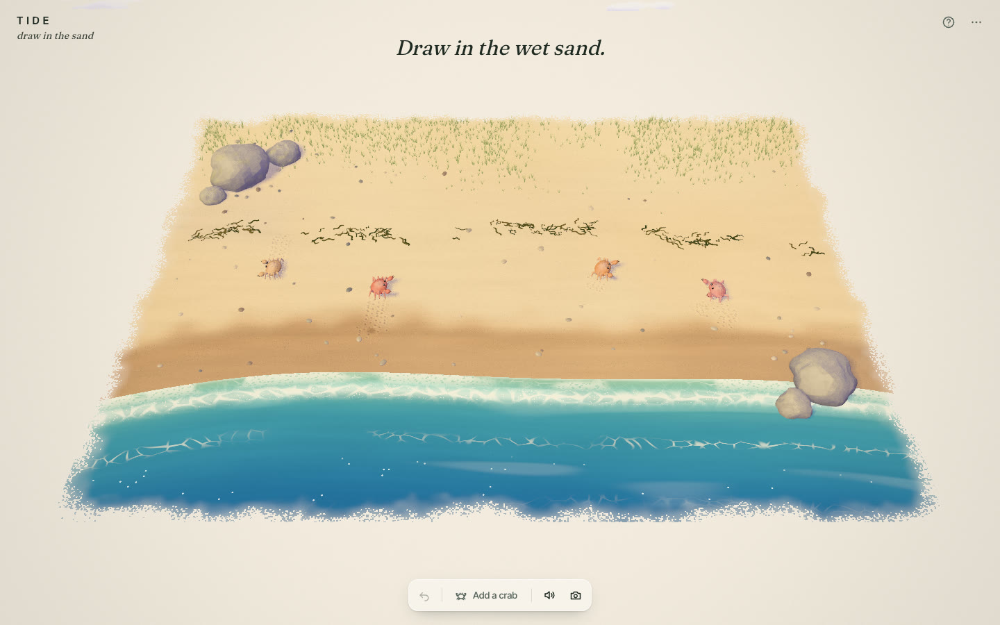
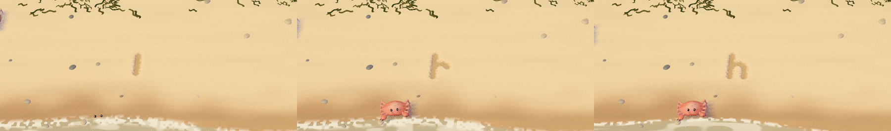
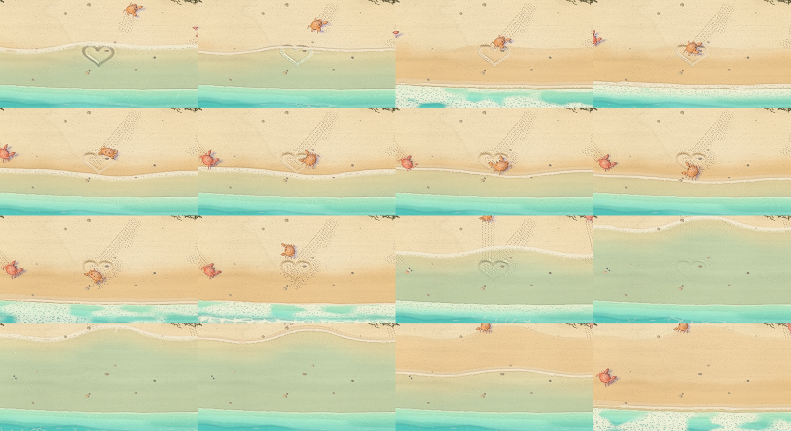
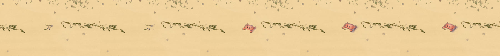
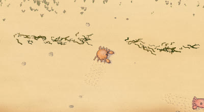
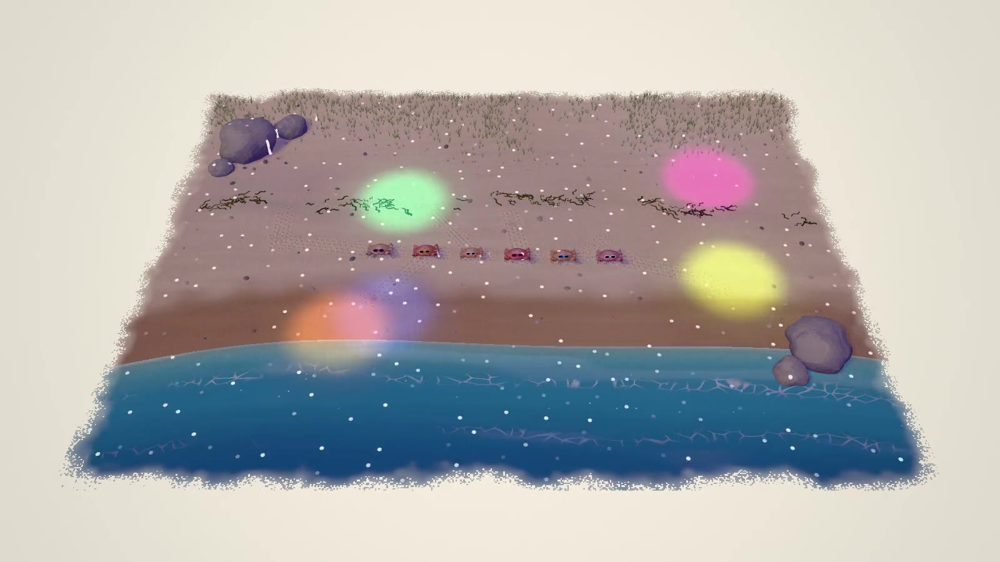
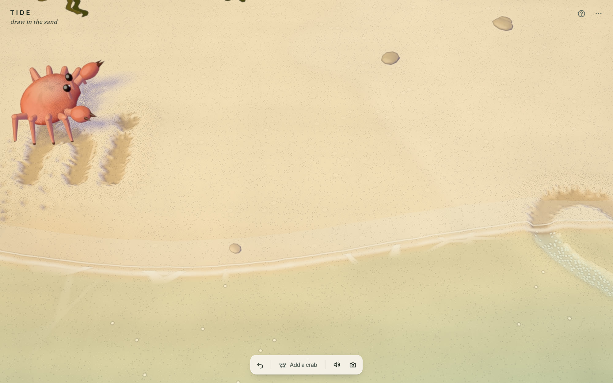
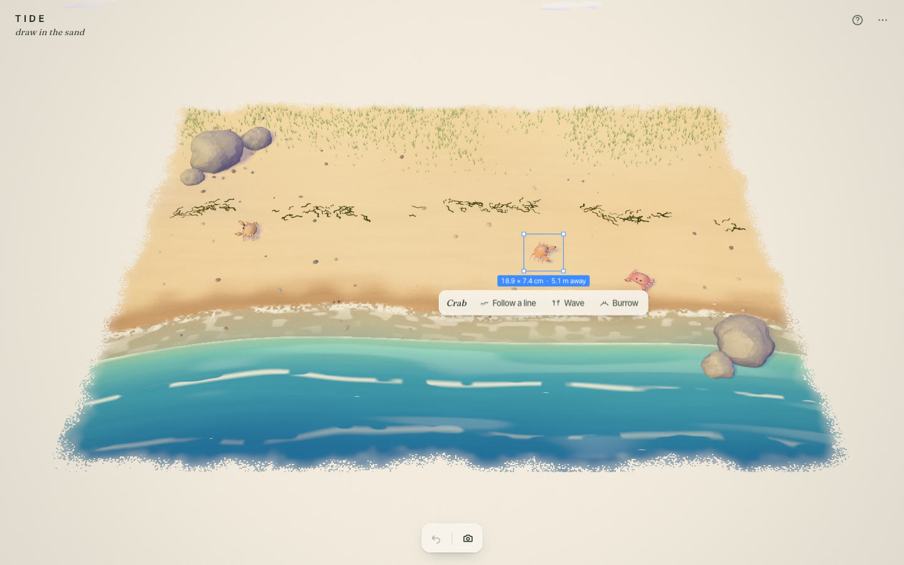
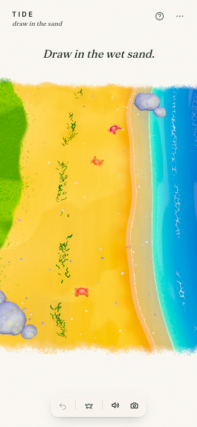

# TIDE

*draw in the sand* — **live at https://tide-interactive.vercel.app**

You draw in the wet sand with your finger. The line stays, pressed into the sand. Little crabs come and walk along it. Then the waves come in and gently wash it away.

TIDE is the fifth piece in a family by the same author — [MEADOW](https://meadow-interactive.vercel.app) (draw a sheep), [POND](https://pond-interactive.vercel.app), [HIVE](https://hive-interactive.vercel.app) and SKY — and the smallest: one gesture, one thing that happens to it.



https://github.com/Mariaareadne1/tide-interactive/raw/main/docs/media/tide-demo.mp4

The dance, with sound:

https://github.com/Mariaareadne1/tide-interactive/raw/main/docs/media/tide-dance.mp4

## What you can do
- **Draw** anywhere on the sand — a word, a heart, a spiral. The groove forms under your finger as you go: a damp, darker trough with a little lip of pushed-up sand either side. On wet sand it is crisp and dark; up on the dry sand it is softer and crumblier.
- **Watch the crabs.** When you lift your finger, the nearest crab scuttles over — sideways — and walks along your line, stopping to look at its corners and ends. On a long line a second one may come and wave.
- **Let the sea take it.** A wave every 5–8 seconds; most reach partway up the wet sand, every fourth or fifth runs high, sometimes onto the dry sand. Where the water reaches, a line softens over two or three waves; foam lingers in what is left of it, and its bubbles pop. Crabs run up the beach ahead of the water or burrow until it passes.
- **Watch for footprints.** Crabs leave little dotted tracks in the sand as they scuttle, and a hollow where they dig in. The waves take those too.
- **Click a crab** for a blue box with its size and its actions: **Follow a line**, **Wave**, **Burrow** / **Come out**, and **Dance**. Drag it to carry it somewhere else.
- **Add a crab.** Press **Add a crab** (or C) and the cursor becomes a small + — MEADOW's placing cross. Draw a shell — a loop — and it shows as a white line over the beach (never pressed into the sand); a crab sized to it digs its way up out of the middle. Or just tap the sand for a crab right there. Esc (or the button) goes back to drawing. Up to ten crabs on the beach.
- **Dance.** Every crab on the beach scuttles into a row along the shore, faces you, and puts on a pair of sunglasses, and dances to disco Beethoven while the lights go down and coloured spotlights and mirror-ball flecks sweep the beach — about twelve seconds, short enough for a demo: a count-in, side-steps, claws up, a hop that ripples down the line, a spin, and a ta-da. If a big wave comes mid-song they dig in, eyes up, and pop back out to finish.
- **Listen.** The surf roars as a wave runs up and hisses as it draws back; your fingertip scratches in the sand (softer on wet sand); crabs bloop when they pop out. One button mutes it all (remembered on this device). Sound starts with your first touch, as browsers require.
- **Undo** smooths your last line back over — unless the sea already has it.
- **Save image** (a PNG of the real scene), and from the menu **Record 12-second clip** (with sound) and **Hide interface**.

Nothing is saved. On reload the beach is smooth again and the crabs are back at home; that's the point.

| Writing | A wave taking a heart |
|---|---|
|  |  |

| Tap to add a crab | Footprints | Everyone dances |
|---|---|---|
|  |  |  |

| Up close | A crab, selected | On a phone |
|---|---|---|
|  |  |  |

Keyboard: ⌘Z undo · Tab select a crab · F / W / B follow, wave, burrow · D dance · C add a crab · M sound · Esc deselect · H hide the interface.

## How it works
- **Vite + TypeScript + plain three.js** with custom `ShaderMaterial`s; React only for the interface. The engine (renderer, painted light, sun shadows, tone curve, camera, recorder) is MEADOW's, by way of HIVE.
- **The sand is a GPU heightmap** — two ping-pong `RGBA16F` render targets over the whole tile (1024 × 768): groove depth, lip, wetness left by the waves, and foam caught in grooves.
  - *Stamping*: each pointer move is smoothed, projected onto the beach, resampled every 2 cm and drawn as segments into the current target with **MAX blending**, scissored to their bounds — cheap, and drawing over a line never deepens it.
  - *Evolving*: once a frame, where the sea covers the sand, grooves smear toward their neighbours (never upward) and decay; wet sand dries; foam lingers and fades.
  - *Undo*: a snapshot is taken before each line; undo paints the line's footprint into a mask and eases the sand inside it back to the snapshot.
  - The beach mesh lowers itself into the heightmap in its vertex shader, and takes its normal from the heightmap per pixel, so a 4 cm groove reads as pressed in under the painted sun.
- **The waves are a pure function of time and seed** (`src/sea/waves.ts`): schedule, reach, run-up/pause/draw-back profile and the wobble of the front. The shaders, the crabs and the CPU mirror all ask the same function, so recordings and tests replay exactly.
- **A small CPU mirror** of each line (its resampled points, each with a strength worn down exactly as the GPU wears down the groove) tells crabs what is left to follow and undo whether the sea has touched it.
- **Crabs** follow MEADOW/POND's pattern: a controller of plans (potter, approach, follow, watch, flee, hide, burrowed, wave, held) and behaviours that are pure functions of time, cross-faded, with squash and stretch and a continuous leg phase.
- **Footprints** come from the crabs' own legs: each leg's phase in the scuttle is known, so when a foot comes down the controller reports where, and a tiny dimple is stamped into the same heightmap (one small scissored batch per crab per frame).
- **The dance** is a pure function of the beat (`src/crabs/dance.ts`), and **the song** (`src/audio/song.ts`) is scheduled on the Web Audio clock from the same BPM and bar layout — Beethoven's Fifth (1808, public domain) as a disco track at 132 BPM: the four-note motto on a brassy saw lead over a string pad, octave-bouncing bass, four-on-the-floor kick, claps and open hats, a riser to count in and a crash on a major-key ta-da, all synthesised, no audio files. The disco lights are one shader function (`disco()` in `src/scene/shaderChunks.ts`) shared by the sand, sea, grass, rocks and crabs, driven by the same beat. The surf and the fingertip scratch are filtered noise driven each frame by the wave clock and the pen.
- **The sea's foam** is cellular: threads of lace on the cell walls for drifting foam lines and receding water, froth (white with small holes) for breaking white water, faint caustics in the shallows — each only computed where it can show.
- **Capture**: the line is in the scene, so the recorder just records the canvas — MP4/H.264 where the browser can, else WebM.
- Touch, pen (pressure deepens the line) and mouse through one pointer state machine; reduced motion gives a slower, gentler sea; dynamic resolution; on WebGL context loss the beach comes back smooth.

## Run it
```bash
npm install
npm run dev          # http://localhost:5388
```

## Check it
```bash
npm test                      # 31 unit tests: strokes, grooves, waves, erosion, crab paths, footfalls, the dance and song, shells, fuzzing
npm run test:e2e              # 19 Playwright tests in real Chromium (Metal ANGLE), against the dev server
E2E_PROD=1 npm run test:e2e   # the same against the production build
npm run typecheck && npm run lint && npm run build
```
QA scripts (need the dev server): `scripts/shoot.mjs`, `draw.mjs` (writes a word and a heart, close-up), `strip.mjs` (a wave taking a heart, with depth read back), `perf.mjs` (GPU-synced), `features.mjs` (footprints, a placed crab hatching, the dance), `demo.mjs` and `demo-dance.mjs` (scripted clips, with sound, through the app's own recorder).

MIT licensed. See [CASE_STUDY.md](CASE_STUDY.md) for how it was made and [PROGRESS.md](PROGRESS.md) for where it stands.
